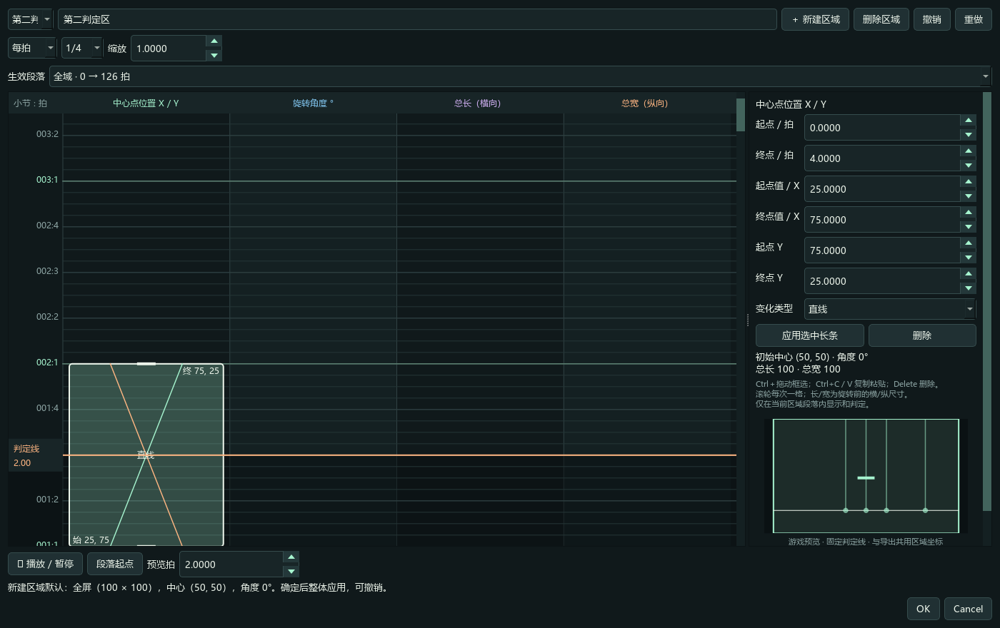
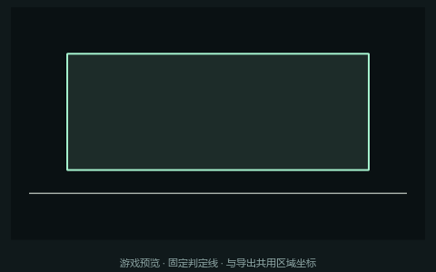
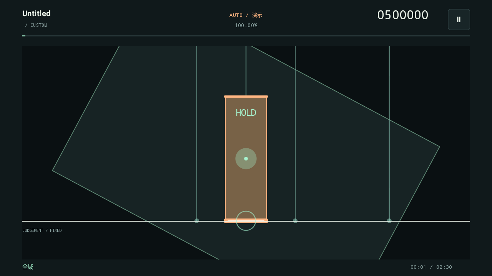

# 0.12.0 发布验证 · 2026-10-28

- Python 单元测试：70 项通过，包含旧工程十次读写、空间单位、Agent 和非法版本拒绝。
- 真实 Qt 控件新功能检查：23 项通过，包含区域默认值、新建删除与撤销、选择传递给 Agent、三种时间轴 Ctrl 边缘滚动与固定拍锚点、0–100 输入、内部重叠边缘像素。
- 既有 Qt 线编辑、数字输入、区域批量、主界面、运动、Agent、播放时钟、非 Ogg 转换回归通过。
- Android 模拟器区域测试：16:9 和 4:3 各 264 项通过，读取实际桌面新旧导出，比较几何，测试并集边缘像素与播放、暂停、Hold 续接。
- Android 轨迹测试：1460 项通过，覆盖 Tap / 弯折 Hold、位置 / 透明度 / 流速与旧格式读取。AT Flow 与 SoundPool 测试：5890 项通过。
- JVM 核心：28 项判定、20 项区域运动、49 项垂直下落轨迹检查通过；622 音符整曲在 30 / 60 / 120 fps 均 1,000,000 分。
- 打包 EXE 实测：区域、轨迹、Agent 草稿、默认模型与遮罩 Key、MP3→Ogg→PCM 试听 5 个诊断入口全部通过；Windows 文件及产品版本均 0.12.0。
- APK 编译与签名校验通过，Android versionName=0.12.0、versionCode=12。未进行额外实体手机测试。

机器可读结果见 [发布测试结果](release-0.12.0-tests.json)；界面检查见 [Qt 测试结果](012-ui-tests.json)。

